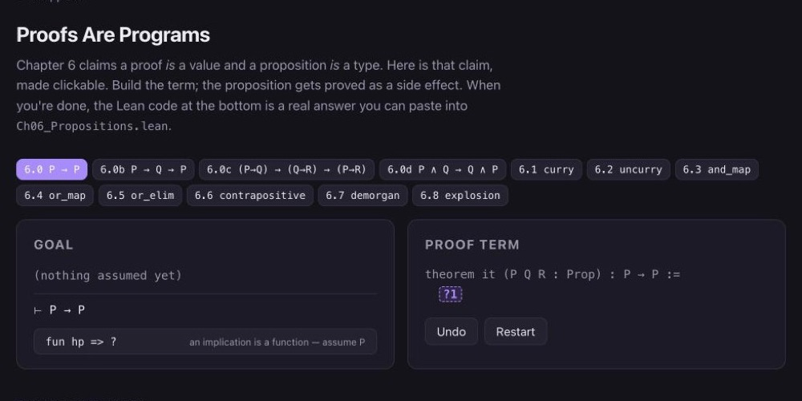

Things I am studying for myself, outside of work, with the tools and detours
they have produced along the way. *Last updated: November 2026.*

## Lean

I became curious about [Lean](https://lean-lang.org) because of its recent
importance in the AI advances in mathematics. When a language model proposes a
proof, something has to check it, and Lean is increasingly that something: a
proof that compiles is a proof, whatever produced it. I wanted to understand
what that checker actually is, from the inside.

My way of learning it was to build the course I wished I had. **Learn Lean** is
a puzzle-driven introduction in 73 exercises across 8 chapters, programming
first and proofs second, with the punchline that they were the same thing all
along. Every exercise ships with a test that stays red until you solve it, so
the editor itself tells you how far you are. Chapter 6 is the hinge, where
propositions become types and proofs become programs, and everything before it
is a well-designed functional language you could have learned elsewhere.

Three browser applets accompany the chapters, for the things that are hard to
see from inside a text editor: a reduction machine that steps through a
recursive function as it rewrites itself, a miniature proof assistant where you
build a proof by clicking term constructors, and a goal-state viewer that
replays real proofs tactic by tactic.

[Source and exercises on GitHub](https://github.com/cjauvin/learn-lean) ·
Lean 4

## Persian



I have been learning Persian (Farsi) for some time now. The central tool is
[Anki](https://ankiweb.net), where I keep a never-ending deck of my own cards.
Most of them are grammar-focused phrases rather than single words, taken from
daily life or, very often, straight from the videos of
[Persian Learning](https://www.youtube.com/@PersianLearning), Majid's YouTube
channel. I wrote up the whole workflow, screenshots and ChatGPT included, in
[Learning Persian with Anki, ChatGPT and YouTube](/posts/learning-persian/).

Along the way I noticed that the hard direction of translation is not the one
we usually think about. Producing the new language is visibly difficult, but
rendering it back into your own, faithfully, turns out to be the deeper
problem. That became
[The reverse difficulty of translation](/posts/reverse-translation/).

The language also pulled in the culture. The
[explorable 3D model of Naqsh-e Jahan Square](https://cjauvin.github.io/naqsh-e-jahaan-3d/)
in Isfahan, with its synthesized Persian soundscape of santur, ney and
tombak, started as a way of walking around in the place the words come from.
It lives on the [Projects](/projects/) page.
